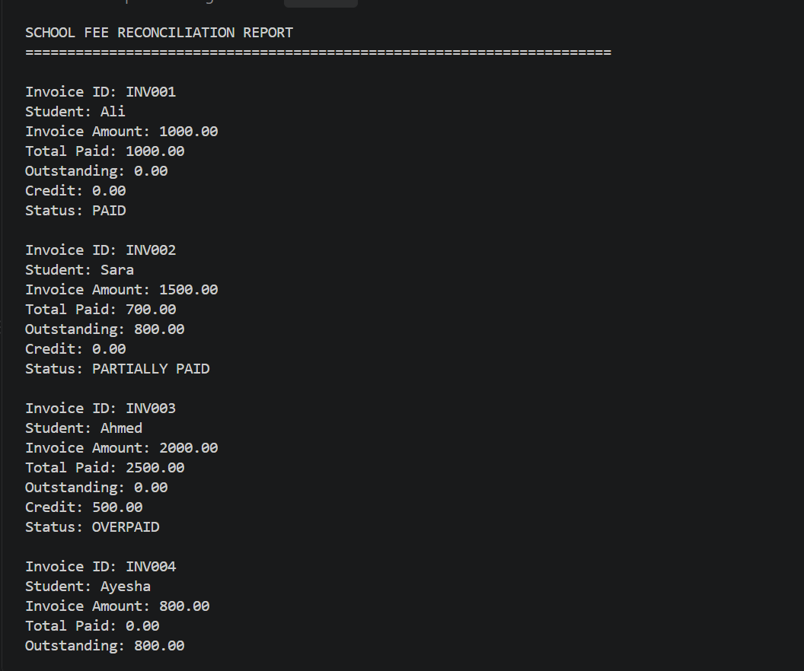
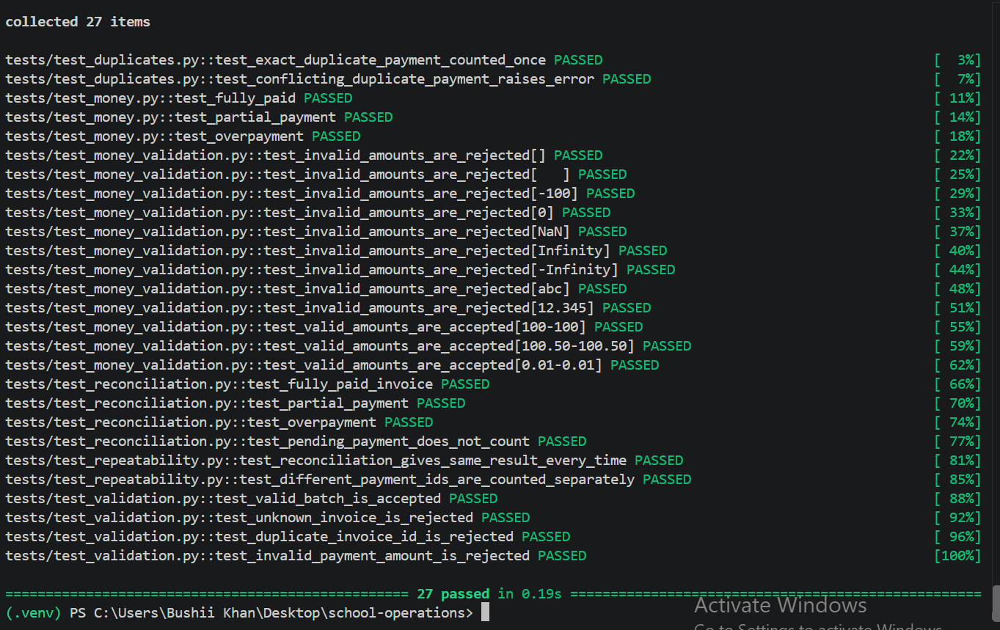
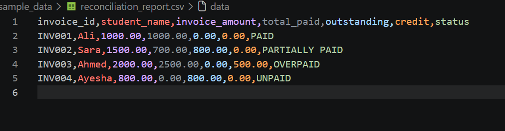

# School Fee Reconciliation System

A Python-based command-line application that reconciles school invoices with payment records using accurate monetary calculations, input validation, duplicate detection, and CSV reporting.

The project demonstrates how Python can automate a school finance workflow and help identify paid invoices, outstanding balances, pending payments, and overpayments.

## Project Overview

Schools need a reliable way to compare issued fee invoices with received payments. This project processes invoice and payment CSV files, validates the records, and generates a reconciliation report for each invoice.

## Features

- **Invoice Reconciliation:** Matches payment records with the correct invoice.
- **Accurate Money Calculations:** Uses Python's `Decimal` for financial calculations instead of floating-point arithmetic.
- **Payment Status Handling:** Counts `POSTED` payments and excludes `PENDING` payments from the paid total.
- **Duplicate Detection:** Counts identical duplicate payment records only once and rejects conflicting records with the same payment ID.
- **Input Validation:** Checks monetary values, invoice IDs, payment IDs, and invoice references.
- **Outstanding Balance:** Calculates the remaining amount without allowing a negative outstanding balance.
- **Overpayment Tracking:** Reports excess payments separately as credit.
- **CSV Reporting:** Reads invoice and payment data from CSV files and exports a reconciliation report.
- **Automated Tests:** Includes tests for calculations, validation, duplicates, and repeatability.

## Technologies Used

- Python 3
- CSV
- Decimal
- Pytest
- Git and GitHub

## Project Structure

```text
School-Fee-Reconciliation-System/
│
├── school_ops/
│   ├── __init__.py
│   ├── money.py
│   ├── validation.py
│   ├── reconciliation.py
│   └── cli.py
│
├── sample_data/
│   ├── invoices.csv
│   ├── payments.csv
│   └── reconciliation_report.csv
│
├── tests/
│   ├── test_money.py
│   ├── test_reconciliation.py
│   ├── test_duplicates.py
│   ├── test_validation.py
│   ├── test_money_validation.py
│   └── test_repeatability.py
│
├── .gitignore
└── README.md
```

## Getting Started

### Prerequisites

- Python 3.10 or a compatible Python 3 version
- pip
- A terminal or command prompt

### 1. Clone the Repository

```bash
git clone https://github.com/bushra-iqbal-png/School-Fee-Reconciliation-System.git
```

### 2. Open the Project Directory

```bash
cd School-Fee-Reconciliation-System
```

### 3. Create a Virtual Environment

```bash
python -m venv .venv
```

Activate it on Windows:

```bash
.venv\Scripts\activate
```

### 4. Install the Testing Dependency

```bash
python -m pip install pytest
```

### 5. Run the Reconciliation System

```bash
python -m school_ops.cli
```

The application reads the sample invoice and payment files, displays the reconciliation results in the terminal, and saves the report to `sample_data/reconciliation_report.csv`.

## Run the Tests

Run the automated test suite with:

```bash
python -m pytest -v
```

The existing tests cover monetary calculations, invoice reconciliation, duplicate payments, input validation, and repeatability.

## Input Data

### Invoices CSV

The invoice file contains the invoice ID, student name, and invoice amount.

```csv
invoice_id,student_name,amount
INV001,Ali,1000.00
INV002,Sara,1500.00
```

### Payments CSV

The payment file contains the payment ID, associated invoice ID, payment amount, and payment status.

```csv
payment_id,invoice_id,amount,status
PAY001,INV001,1000.00,POSTED
PAY002,INV002,500.00,POSTED
PAY003,INV002,200.00,POSTED
```

## Example Reconciliation Results

| Invoice ID | Invoice Amount | Total Paid | Outstanding | Credit | Status |
|---|---:|---:|---:|---:|---|
| INV001 | 1000.00 | 1000.00 | 0.00 | 0.00 | PAID |
| INV002 | 1500.00 | 700.00 | 800.00 | 0.00 | PARTIALLY PAID |
| INV003 | 2000.00 | 2500.00 | 0.00 | 500.00 | OVERPAID |
| INV004 | 800.00 | 0.00 | 800.00 | 0.00 | UNPAID |

*Illustrative example of the reconciliation logic.*

---

## Screenshots

### Reconciliation Report



### Automated Test Results



### Generated CSV Report



## Business Rules

1. Invoice and payment amounts must be greater than zero and support no more than two decimal places.
2. Only `POSTED` payments contribute to the total paid amount.
3. `PENDING` payments do not reduce the outstanding balance.
4. An identical duplicate payment ID is counted only once.
5. A conflicting record with an existing payment ID must be rejected.
6. Payments must reference an existing invoice.
7. Outstanding balances cannot be negative.
8. Any overpayment is reported separately as credit.

## Project Scope

This is a command-line Python project that processes CSV files and generates a reconciliation report. It is not a complete school management website or an online fee collection system.

## Future Improvements

- Add a database for persistent invoice and payment records.
- Develop a web-based dashboard for school administrators.
- Add secure user authentication and role-based access.
- Support downloadable financial reports and reconciliation summaries.
- Integrate with an authorized payment system.

## Author

**Bushra Iqbal**

Python Learner | Web Development Student

GitHub: [bushra-iqbal-png](https://github.com/bushra-iqbal-png)

This project is part of my learning journey in Python programming, data validation, financial calculations, automation, and software testing.